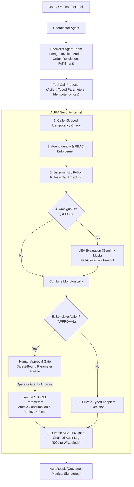

# AURA — AI Agent Security & Execution-Enforcement Gateway

AURA is an enterprise-grade security kernel and execution-enforcement gateway for multi-agent systems. AI agents propose tool operations, but **AURA makes every authorization decision, enforces cryptographic parameter freezing, executes approved actions through private typed adapters, and maintains a tamper-evident audit log**.

Every protected tool operation, across every agent and modality, must pass through:
```python
AURA.handle(request, run_ctx)
```

---

## 🛡️ Core Security Guarantees

1. **Centralized Enforcement**: Agents receive function schemas, never credentials, connection strings, or executable adapters.
2. **Fail-Closed Architecture**: Any error, missing resource, policy conflict, or JEV timeout fails closed to `Decision.BLOCK`.
3. **Monotone Risk Combination**: JEV can never relax or downgrade a deterministic policy risk (`final_risk = max(rule_risk, jev_risk)`).
4. **Zero-Counter Invariant**: Blocked actions never execute their underlying adapter; execution counters remain strictly zero.
5. **Cryptographic Parameter Freezing**: Approval records are cryptographically bound to the SHA-256 digest of `(action, stored_params, agent_id)`. Execution consumes the *stored parameters*, preventing parameter-tampering attacks.
6. **Zero Privilege Inheritance**: Receiving a delegated task from a higher-privileged agent does not grant the receiver any additional permissions.
7. **Caller-Scoped Idempotency**: Safe function-call retries return cached outcomes; modified parameters trigger `IDEMPOTENCY_CONFLICT`. Unknown external timeouts are held in `UNKNOWN` state until verified and reconciled.
8. **Tamper-Evident SHA-256 Hash Chaining**: Every audit entry is cryptographically linked to the prior entry in SQLite WAL mode (`current_hash = SHA256(prev_hash || payload)`).

---

## 🏛️ System Architecture



---

## 🤖 Multi-Agent Team (7 Specialists)

| Agent ID | Role | Responsibilities | Authorized Tools |
|---|---|---|---|
| `coordinator_agent` | `coordinator` | Workflow creation, task delegation, dependency tracking | `read_file` (public, internal) |
| `image_agent` | `image_inspector` | Inspects authorized product images for visible physical damage | `read_product_image`, `analyze_damage` |
| `invoice_agent` | `invoice_processor` | Ingests and extracts structured invoice data from PDFs | `read_invoice_pdf`, `extract_invoice_details` |
| `audio_agent` | `audio_processor` | Ingests and transcribes customer voice messages | `transcribe_customer_audio` |
| `order_agent` | `order_verifier` | Queries order records and validates return/replacement eligibility | `lookup_order`, `check_return_eligibility` |
| `resolution_agent` | `resolution_specialist` | Synthesizes case evidence, requests financial refunds, customer updates | `lookup_order`, `check_return_eligibility`, `create_refund`, `create_replacement`, `send_customer_update` |
| `fulfillment_agent` | `fulfillment_specialist` | Executes authorized product replacement orders and fulfillment | `create_refund`, `create_replacement`, `send_customer_update` |

---

## 🛠️ Specialized Tool Adapters (10 Adapters)

All adapters enforce strict Pydantic parameter schemas, reject path traversal attacks, and execute through private typed interfaces:

1. `read_product_image(image_id)` — Validates and loads customer photo assets.
2. `analyze_damage(image_id)` — Detects cracks, fractures, impact damage, and confidence scores.
3. `read_invoice_pdf(doc_id)` — Validates and parses invoice PDF documents.
4. `extract_invoice_details(doc_id)` — Extracts structured order ID, customer name, purchase date, and total.
5. `transcribe_customer_audio(audio_id)` — Transcribes recorded audio complaints into structured text.
6. `lookup_order(order_id)` — Queries authoritative order database records.
7. `check_return_eligibility(order_id)` — Applies 30-day return policy and damaged-on-arrival rules.
8. `create_refund(order_id, amount)` — Financial refund operation (**deterministically gates on human approval**).
9. `create_replacement(order_id, product_id)` — ERP warehouse fulfillment operation (**deterministically gates on human approval**).
10. `send_customer_update(email, message)` — Outbound notification adapter (**blocked if session is tainted**).

---

## 🚀 Quick Start & CLI Command Center

### 1. Installation
```bash
git clone <repo-url>
cd AURA_PES
pip install -e ".[dev]"
```

### 2. Run Comprehensive Automated Test Suite
```bash
python -m pytest tests/ -v
```
*Current test suite: **192 / 192 passed** across unit, concurrency, security matrix, crash recovery, multi-agent orchestration, and workflow engine.*

### 3. Launch Interactive Terminal Command Center
```bash
python -m aura.cli
```
Opens the 12-section Rich Command Center:
- `[1]` Executive System Dashboard
- `[2]` Multi-Agent Registry & Identities
- `[3]` Agent Permissions & RBAC Matrix
- `[4]` Run Customer Refund & Replacement Multi-Agent DAG
- `[5]` Run Security Demonstrations (Demos A through I)
- `[6]` Human-in-the-Loop Approval Queue
- `[7]` Idempotency & Duplicate Prevention Monitor
- `[8]` Tamper-Evident SHA-256 Audit Explorer
- `[9]` Security Interceptions & Threat Events
- `[10]` Performance & Latency Telemetry
- `[11]` Autonomous Gemini Agent Task Runner
- `[12]` Exit Command Center

---

## 🏆 Primary Demonstration Scenario: Customer Refund & Replacement

Run the primary hackathon scenario directly:
```bash
python -m aura.cli --workflow customer-refund
```

**Scenario prompt:**
> *"My blender arrived broken. Here's a photo (`photo-5521.jpg`), my invoice (`invoice-8834.pdf`), and I recorded a message (`voice-2210.mp3`). I want a refund and a replacement."*

**Execution Lifecycle:**
1. **Concurrent Specialist Execution**: Image Inspector, Invoice Processor, and Audio Processor analyze evidence concurrently.
2. **Order Verification**: Order Verifier checks `ORD-9921` against authoritative records and confirms return eligibility under `DAMAGED_ON_ARRIVAL_POLICY_V2`.
3. **Approval Gating**: Resolution Agent proposes refund ($129.99) and Replacement Order (`PROD-BLENDER-7`). AURA intercepts both operations with `Decision.APPROVAL`, freezing parameters and computing SHA-256 action digests.
4. **Human Review**: Human operator inspects frozen parameters and grants approval.
5. **Atomic Execution**: Gateway consumes the approval tokens and executes stored actions.
6. **Customer Update**: Resolution Agent dispatches dispatch confirmation to customer.
7. **Audit Verification**: Full hash chain verified from genesis block.

---

## 🔒 Repeatable Security Demonstrations (Demos A through I)

Run all 9 repeatable security tests with rich visual tables:
```bash
python -m aura.cli --demo
```

- **Demo A (Authorized Tool Execution)**: Image Agent reads `photo-5521.jpg` -> `Decision.ALLOW`, `status="success"`.
- **Demo B (Unauthorized RBAC Enforcement)**: Image Agent attempts `create_refund` -> `Decision.BLOCK`, `PERMISSION_DENIED`, adapter zero-counter held.
- **Demo C (Safe Idempotent Retry)**: Order Agent repeats lookup with identical key -> returns cached result without re-executing adapter.
- **Demo D (Idempotency Conflict Defense)**: Reusing an idempotency key with altered parameters triggers `IDEMPOTENCY_CONFLICT`.
- **Demo E (Human Approval Lifecycle & Replay Defense)**: Financial refund requires human approval, executes stored parameters upon approval, and blocks subsequent replay attempts.
- **Demo F (Inter-Agent Injection Neutralization)**: Untrusted prompts in inter-agent messages are marked tainted and cannot escalate privileges or bypass RBAC.
- **Demo G (JEV Timeout Fail-Closed)**: JEV latency spikes or provider timeout deterministically fails closed to `Decision.BLOCK`.
- **Demo H (External Ambiguity Reconciliation)**: Ambiguous external network timeout holds record in `UNKNOWN` state; blind retries are blocked until safely reconciled.
- **Demo I (Full Multi-Agent End-to-End Workflow)**: 8-task DAG executed by 7 specialist agents with approval pause, resumption, and audit verification.

---

## 📊 Evaluation & Verification

To verify audit trail integrity independently:
```bash
python -m aura.cli --verify-audit
```
